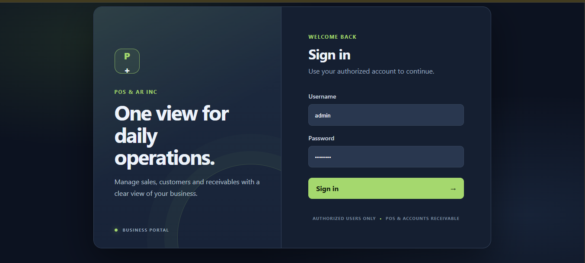
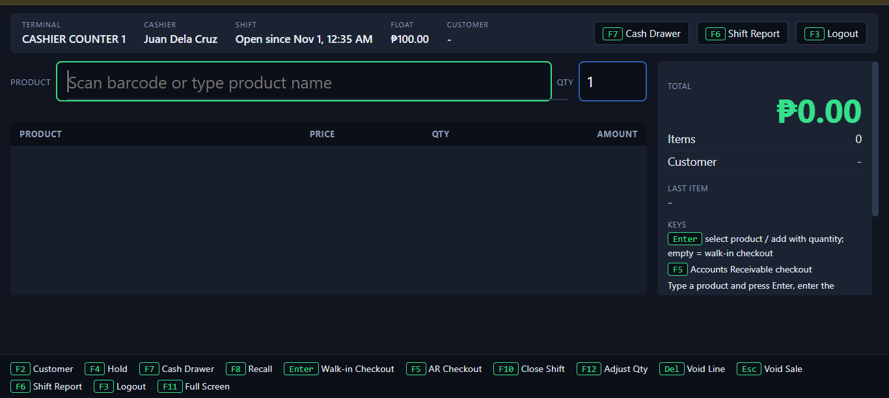
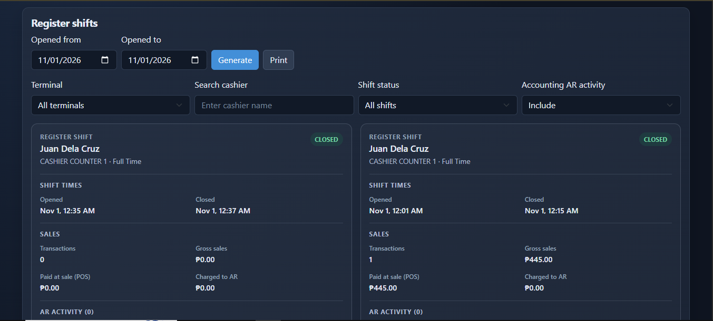
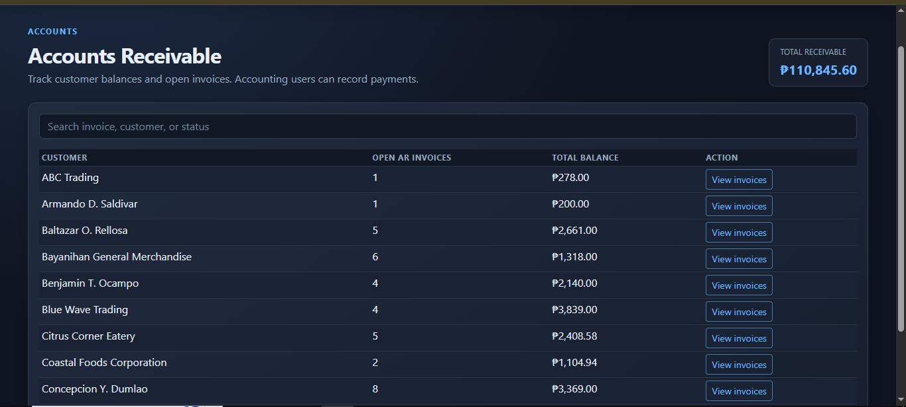
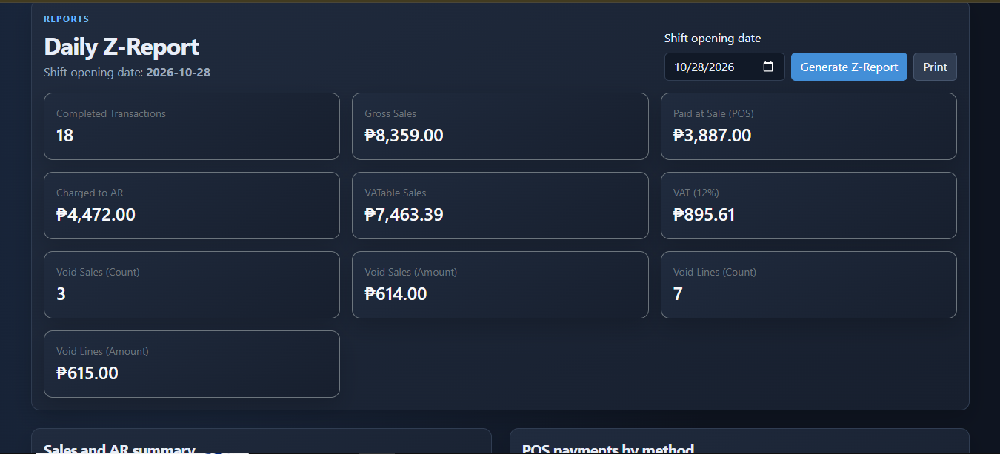
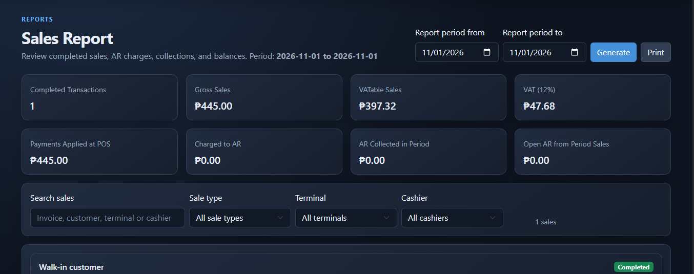
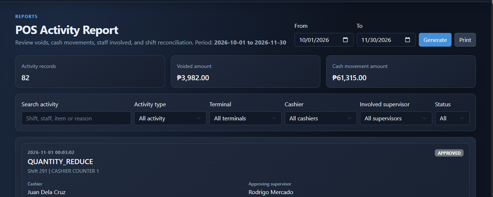

# POS & Accounts Receivable System

A browser based point of sale and accounts receivable system for managing cashier shifts, sales, customer balances, invoice payments, and operational reports.

## Screenshots

### Login

The system sign-in page for authorized users.



### Cashier POS

The active register view with cashier, terminal, starting float, cart items, and keyboard controls.



### Shift Report

Shift times, float amounts, sales totals, and the register shift breakdown.



### Accounting AR

Customer invoices, outstanding balances, payment history, and invoice due status.



### Daily Z-Report

The selected business date summary and its register shift breakdown.



### Sales Report

Sales report filters and the sales results displayed on screen.



### POS Activity

Supervisor-approved POS actions and the staff involved in each recorded activity.



## Features

- POS sales for walk-in customers and Accounts Receivable (AR) customers.
- Customer, product, category, payment method, terminal, schedule, and user administration.
- Cashier shifts with starting float, cash drops, float adjustments, and closing reconciliation.
- Held and recalled sales, supervisor PIN approvals for voids and quantity reductions, and saved cart recovery after a page refresh during the same open shift.
- Customer invoices, AR payments, aging and credit-limit notices, and invoice email delivery.
- Shift, daily Z, sales, and POS activity reports. Reports support filters and landscape printing.
- Role based workspaces for Admin, Cashier, Accounting, and Supervisor.

## Technology and requirements

- XAMPP or another Apache, PHP, and MySQL/MariaDB stack.
- PHP with PDO MySQL enabled.
- MariaDB/MySQL. The included database export was generated with MariaDB 10.4.32.
- Composer and PHPMailer for email features.
- A modern browser. Bootstrap, Axios, SweetAlert2, and QR code assets load from CDNs, so the browser needs internet access for those resources.

## Local setup with XAMPP

1. Place the project in the Apache document root, for example `C:\xampp\htdocs\pos_ar_system`.
2. Start Apache and MySQL from the XAMPP Control Panel.
3. In phpMyAdmin, create a database named `pos_ar_database`, select it, then import `pos_ar_database.sql`. The export contains the application tables and seed records. Use a new database for this import.
4. Set the database host, name, username, and password for your local MySQL server in `api/connection-pdo.php`.
5. Open `js/config.js` and make sure `baseUrl` points to the project URL. The default expects the project at `/pos_ar_system`:

   ```js
   export const baseUrl = `${window.location.origin}/pos_ar_system`;
   ```

   If the folder or virtual host uses a different URL, update this value. The API URLs are derived from it.
6. Open `http://localhost/pos_ar_system/` and sign in with an account provisioned in the database. Do not use sample credentials for a live deployment; create and assign authorized accounts.

The database export is for a fresh installation. This checkout does not include incremental database migration scripts. Back up an existing database and compare its schema with `pos_ar_database.sql` before applying schema changes; do not import the full export over production data.

## Email setup

Email features use PHPMailer. From the project root, install it with Composer:

```powershell
composer require phpmailer/phpmailer:^7.1
```

Configure SMTP for the PHP/Apache environment with these variables:

| Variable | Purpose |
| --- | --- |
| `POS_AR_SMTP_HOST` | SMTP server, for example `smtp.gmail.com` |
| `POS_AR_SMTP_PORT` | SMTP port, commonly `465` for SSL or `587` for TLS |
| `POS_AR_SMTP_ENCRYPTION` | `ssl`, `tls`, or blank |
| `POS_AR_SMTP_USERNAME` | SMTP account username |
| `POS_AR_SMTP_PASSWORD` | SMTP password or provider app password |
| `POS_AR_MAIL_FROM` | Sender email address |
| `POS_AR_MAIL_NAME` | Sender display name |

Alternatively, create the ignored local file `mailer_details.local.php` in the project root and return an array with `host`, `port`, `encryption`, `username`, `password`, `from_email`, and `from_name` keys. Keep SMTP credentials out of source control. For Gmail, use an App Password with 2-Step Verification enabled.

Completed AR invoices can be emailed with their PDF. The Aging Report allows one reminder per customer for each overdue aging band. Credit-limit notices are sent manually and are limited to each over-limit period. To send scheduled unpaid-invoice reminders, configure Windows Task Scheduler to run the following daily, using the PHP executable installed with XAMPP:

```text
<xampp-folder>\php\php.exe <project-folder>\api_functional\email_notifications.php
```

Set the task's **Start in** directory to the project root and ensure the scheduled task can read the SMTP settings and database configuration.

## Workspaces

| Role | Main pages and responsibilities |
| --- | --- |
| Admin | Dashboard and setup pages for users, roles, products, categories, customers, payment methods, units, terminals, schedules, and terminal assignments. Admin reports are under `interface/Admin/functional/`. |
| Cashier | `interface/Cashier/pos.html` for sales and `shift_report.html` for the active shift. Cashiers start and close shifts with supervisor PIN approval. |
| Accounting | AR invoices and payments, Aging Report, Credit Limit Report, POS Activity, Sales Report, Shift Report, and Daily Z-Report. |
| Supervisor | Supervisor PIN management plus Sales, Shift, and Daily Z reports. Supervisors approve protected cashier actions using their PIN. |

The login page is `index.html`. A successful login routes the user to the workspace assigned to their role. Page access is checked by `js_functional/session.js` and by the API session endpoints.

## Typical operating flow

1. An Admin configures products, customers, payment methods, cashier terminals, schedules, and user accounts.
2. A Cashier signs in, starts a shift with the supervisor-approved starting float, scans or searches products, and enters quantities.
3. The Cashier completes a walk-in payment or selects a customer and posts the sale to AR. Unfinished cart lines are saved in the current browser tab and restored after a refresh for the same open shift.
4. Accounting reviews invoices, records customer payments, and uses aging, credit-limit, and activity reports to follow up on balances.
5. At shift end, the Cashier counts the drawer and closes the shift with supervisor approval. Admin, Accounting, and Supervisor users can review shift and daily reports.

## POS keyboard controls

| Key | Action |
| --- | --- |
| `Enter` | Select a product, enter its quantity, then add it; with an empty product field, start walk-in checkout |
| `F2` | Select a customer |
| `F4` | Hold the current sale |
| `F5` | Start AR checkout |
| `F6` | Open the shift report |
| `F7` | Open cash drawer controls |
| `F8` | Recall or remove a held sale (removal requires supervisor PIN) |
| `F10` | Close the shift |
| `F12` | Adjust the selected cart line quantity |
| `+` / `-` | Increase quantity / reduce quantity; reductions require supervisor approval |
| `Delete` | Void the selected line with supervisor approval |
| `Escape` | Void the sale with supervisor approval |
| `F3` | Log out |
| `F11` | Toggle full screen |

Use the arrow keys to select a cart line before using `F12`, `+`, `-`, or `Delete`.

## Project layout

```text
api/                         Shared authentication, session, and master-data APIs
api_functional/              POS, shift, report, invoice, payment, and email APIs
interface/                   HTML pages grouped by role and shared design files
js/                          Shared browser configuration and login modules
js_functional/               Session handling and feature-specific browser modules
pos_ar_database.sql          Full database schema and seed data for a fresh install
invoices/                    Generated invoice PDFs
mailer_details.php           SMTP environment and local configuration loader
REQUIRMENTS.txt              Additional project and email setup notes
```

## Reports and printing

- **Shift Report** summarizes register shifts, opening float, sales, and shift activity. Accounting AR collections are shown separately where applicable.
- **Daily Z-Report** summarizes the selected business date and its register shift breakdown.
- **Sales Report** summarizes completed sales and supports filtering and printing.
- **POS Activity** records supervisor-approved voids, line voids, quantity reductions, cash drops, and float adjustments, including the staff involved.
- **Aging Report** groups unpaid invoices by age and supports manual email reminders.
- **Credit Limit Report** shows customer credit usage and supports manual notices when the limit is reached or exceeded.

Reports are designed for responsive on-screen use and landscape printing. Some report cards are converted to table layouts for print.

## Operational notes

- The project uses the `Asia/Manila` timezone for shift and notification processing.
- The cart draft is kept in browser `sessionStorage`, scoped to the open shift. It survives a page refresh in that browser tab; closing the tab ends that browser session.
- Generated invoice PDFs are stored under `invoices/` and are ignored by Git. Protect this directory and database backups according to your organization's data-retention policy.
- Keep production database and SMTP credentials out of source control. Restrict database, API, and report access to authorized users.
